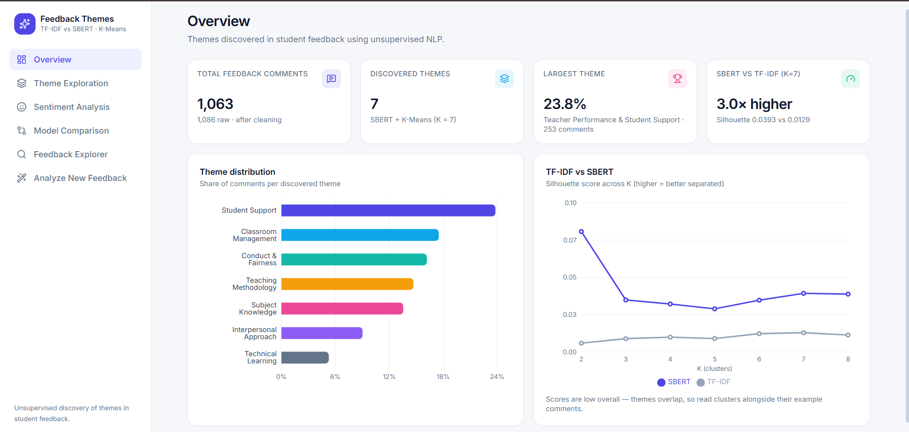
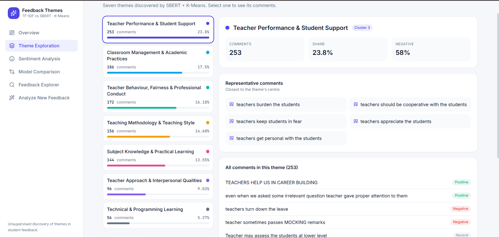
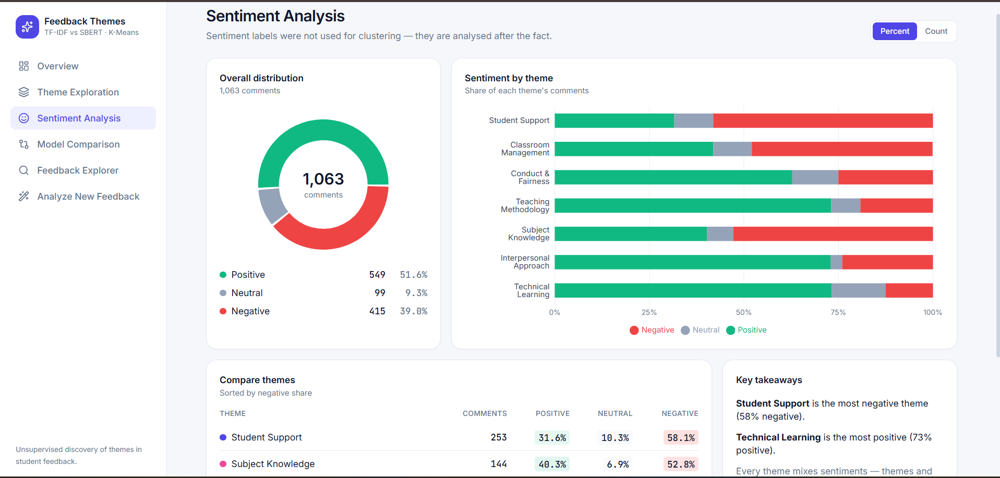
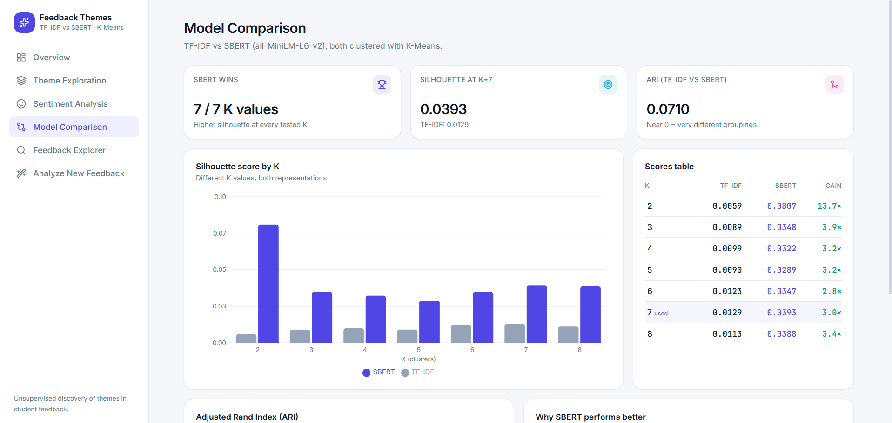
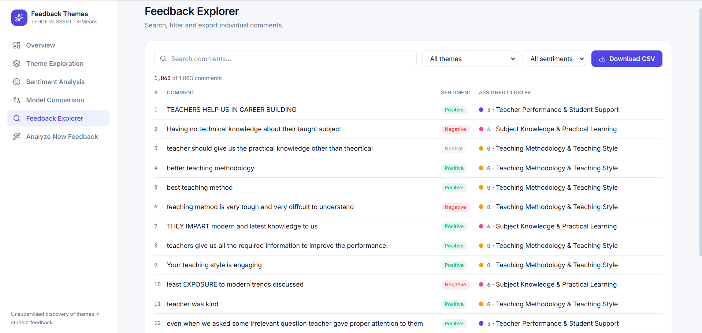
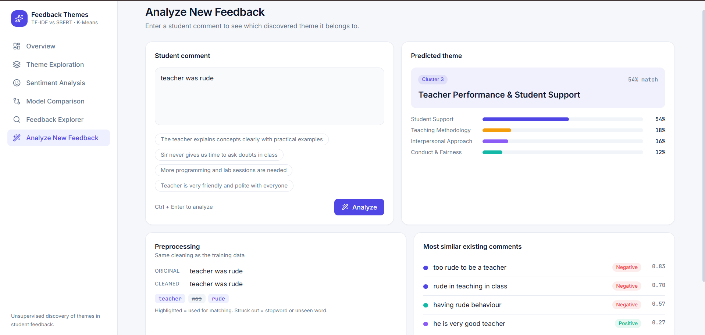

# Student Feedback Theme Discovery Using Unsupervised NLP

An end-to-end project that explores student feedback using
**unsupervised Natural Language Processing (NLP)**. It compares TF-IDF
and Sentence-BERT (SBERT) representations with K-Means clustering,
interprets the discovered themes, and presents the results through an
interactive React dashboard.

The project combines: - **NLP experimentation:** preprocessing, text
representation, clustering, evaluation, and error analysis. -
**Interactive dashboard:** a React + Vite interface for exploring
themes, sentiment, model comparisons, and individual feedback comments.

------------------------------------------------------------------------

## Dashboard Preview

The dashboard screenshots below are stored in `frontend/screenshots/`.
Add your own screenshots using these filenames and they will render
automatically on GitHub.

### 1. Overview Dashboard



### 2. Theme Exploration



### 3. Sentiment Analysis



### 4. Model Comparison



### 5. Feedback Explorer



### 6. Analyze New Feedback



> **Adding screenshots:** Create the folder `frontend/screenshots/` in
> the repository. Save each screenshot with the exact filename shown
> above, then commit and push the images along with this README. Use PNG
> or JPG files; if you use JPG, update the corresponding image extension
> in this README.

------------------------------------------------------------------------

## Overview

Student feedback contains useful information about teaching quality,
classroom practices, teacher behaviour, and learning experiences.
Manually reviewing a large collection of comments can be time-consuming.

This project applies unsupervised NLP to identify recurring patterns in
student feedback without using predefined topic labels during
clustering.

Two text representation approaches are evaluated:

-   **TF-IDF:** a traditional lexical representation.
-   **SBERT (`all-MiniLM-L6-v2`):** dense sentence embeddings designed
    to capture semantic similarity.

K-Means is applied independently to both representations. Clustering
quality is compared using the Silhouette Score. The final SBERT clusters
are interpreted using representative comments, theme distributions,
sentiment distributions, and boundary-based error analysis.

The dashboard makes the analysis easier to inspect without requiring
users to open the notebooks or manually read the result files.

------------------------------------------------------------------------

## Objectives

-   Explore and understand student feedback data.
-   Preprocess textual feedback for NLP analysis.
-   Establish a TF-IDF + K-Means baseline.
-   Generate semantic embeddings using SBERT.
-   Apply K-Means to discover feedback themes.
-   Compare TF-IDF and SBERT representations quantitatively.
-   Interpret discovered clusters using representative comments.
-   Analyse sentiment distribution across discovered themes.
-   Inspect individual feedback comments.
-   Present the analysis through an interactive dashboard.
-   Examine ambiguous and overlapping feedback through error analysis.

------------------------------------------------------------------------

## Dataset

The project uses the **Student Feedback Dataset**.

**Source:** [Student Feedback Dataset on
GitHub](https://github.com/mbalvi/student_feedback_data/blob/main/Student_Feedback.csv)

### Dataset characteristics

  Property                                         Value
  ----------------------- ------------------------------
  Original rows                                    1,086
  Columns                                              2
  Approximate file size                            51 KB
  Text column                                 `comments`
  Sentiment column                          `sentiments`
  Missing values            None in the original dataset

### Columns

  -----------------------------------------------------------------------
  Column                  Type                    Description
  ----------------------- ----------------------- -----------------------
  `comments`              String                  Student feedback text

  `sentiments`            Integer                 Sentiment label
                                                  associated with the
                                                  feedback
  -----------------------------------------------------------------------

Sentiment labels are used for **post-clustering analysis and
interpretation**. They are not used as inputs to the unsupervised
clustering process.

------------------------------------------------------------------------

## Methodology

``` text
                   Student Feedback
                          |
                          v
                   Data Understanding
                          |
                          v
                     Preprocessing
                          |
             +------------+------------+
             |                         |
             v                         v
           TF-IDF                    SBERT
             |                         |
             v                         v
          K-Means                   K-Means
             |                         |
             v                         v
      Silhouette Score          Silhouette Score
             |                         |
             +------------+------------+
                          |
                          v
                      Comparison
                          |
                          v
                 Theme Interpretation
                          |
                          v
                    Error Analysis
                          |
                          v
                  Dashboard Exploration
```

------------------------------------------------------------------------

## Text Preprocessing

The preprocessing pipeline includes:

-   Handling missing or invalid text entries.
-   Removing duplicate feedback.
-   Text normalization.
-   Cleaning unnecessary characters.
-   Tokenization.
-   Stopword handling.
-   Basic linguistic normalization.
-   Calculating text statistics such as word and character counts.

Processed data is stored under:

``` text
data/processed/
```

------------------------------------------------------------------------

## Feature Representation

### 1. TF-IDF

TF-IDF is used as the traditional baseline representation.

The implementation uses: - Word-level features. - Unigrams and
bigrams. - A maximum of 3,000 features.

TF-IDF represents comments based primarily on lexical content and word
importance.

### 2. SBERT

The project uses the sentence-transformer model:

``` text
all-MiniLM-L6-v2
```

SBERT generates dense sentence embeddings. Unlike TF-IDF, it captures
semantic relationships between sentences, allowing comments with
different wording but similar meanings to be represented closer together
in embedding space.

------------------------------------------------------------------------

## Clustering

K-Means clustering is applied independently to the TF-IDF and SBERT
representations.

Multiple values of `K` are evaluated using the **Silhouette Score** to
examine cluster separation. The final SBERT clustering is also
interpreted qualitatively to identify meaningful feedback themes.

------------------------------------------------------------------------

## Results

### TF-IDF vs SBERT

SBERT produced higher Silhouette Scores than TF-IDF across the tested
cluster counts.

  Representation     K   Silhouette Score
  ---------------- --- ------------------
  TF-IDF             7             0.0129
  SBERT              2             0.0807

At **K = 7**:

  Representation     Silhouette Score
  ---------------- ------------------
  TF-IDF                       0.0129
  SBERT                        0.0393

These results indicate that SBERT provides better semantic separation
than the TF-IDF baseline on this dataset.

However, the absolute Silhouette Scores remain relatively low. The
clusters should therefore not be interpreted as sharply separated
topics. Quantitative evaluation is combined with qualitative inspection
of representative comments.

------------------------------------------------------------------------

## Discovered Themes

The final SBERT-based analysis identified seven interpretable themes:

    Cluster Theme
  --------- ----------------------------------------------------
          0 Teaching Methodology & Teaching Style
          1 Technical & Programming Learning
          2 Teacher Approach & Interpersonal Qualities
          3 Teacher Performance & Student Support
          4 Teacher Behaviour, Fairness & Professional Conduct
          5 Classroom Management & Academic Practices
          6 Subject Knowledge & Practical Learning

Cluster sizes ranged from **56 to 253 comments**.

The largest discovered theme was **Teacher Performance & Student
Support**, with **253 comments**.

------------------------------------------------------------------------

## Sentiment Analysis by Theme

Sentiment labels were not used to create the clusters. They were
analysed after clustering to understand whether sentiment was associated
with particular themes.

The discovered clusters contain multiple sentiment categories, so they
should not be interpreted as purely positive or negative groups.

Examples of themes with relatively high proportions of negative-labelled
feedback:

  Theme                                         Negative-labelled feedback
  ------------------------------------------- ----------------------------
  Teacher Performance & Student Support                             58.10%
  Subject Knowledge & Practical Learning                            52.78%
  Classroom Management & Academic Practices                         47.85%

Theme and sentiment are related analytical dimensions, but they are not
equivalent concepts.

------------------------------------------------------------------------

## Model Agreement

The Adjusted Rand Index (ARI) between the TF-IDF and SBERT K=7 cluster
assignments was:

``` text
ARI = 0.0710
```

The low agreement indicates that the two representations produced
substantially different cluster structures. This is expected to some
extent because TF-IDF primarily captures lexical overlap, while SBERT
captures semantic similarity.

------------------------------------------------------------------------

## Error Analysis

The clustering results reveal several sources of ambiguity.

### 1. Overlapping themes

Some comments discuss multiple concepts simultaneously, such as teaching
methodology and practical learning. Assigning such feedback to only one
cluster can be ambiguous.

### 2. Generic feedback

Comments such as "everything is good about the faculty members" provide
limited topical information.

### 3. Short comments

Very short feedback comments contain less context and can be difficult
to place reliably in semantic clusters.

### 4. Mixed feedback

Some comments combine positive and negative observations or discuss
several aspects of teaching within the same sentence. A single-cluster
assignment may not fully represent them.

### 5. Boundary analysis

The difference between cosine similarity to the two nearest cluster
centroids was used to identify comments close to the boundary between
discovered SBERT clusters.

  Boundary threshold     Comments   Percentage
  -------------------- ---------- ------------
  Difference \< 0.01           16        1.51%
  Difference \< 0.02           32        3.01%
  Difference \< 0.05          110       10.35%

This indicates that some feedback lies close to cluster boundaries and
may not belong clearly to one theme.

------------------------------------------------------------------------

## Interactive Dashboard

The frontend provides a visual interface for exploring the generated
analysis.

  -----------------------------------------------------------------------
  Section                             Purpose
  ----------------------------------- -----------------------------------
  **Overview**                        Displays high-level feedback
                                      statistics, discovered themes, the
                                      largest theme, and model comparison
                                      information.

  **Theme Exploration**               Shows the discovered themes, their
                                      sizes, percentages, and
                                      representative comments.

  **Sentiment Analysis**              Explores positive, negative, and
                                      neutral feedback distributions and
                                      sentiment across themes.

  **Model Comparison**                Compares TF-IDF and SBERT
                                      clustering results using Silhouette
                                      Scores and model agreement
                                      information.

  **Feedback Explorer**               Allows users to inspect, search,
                                      and filter individual feedback
                                      records.

  **Analyze New Feedback**            Provides the interface for entering
                                      a new feedback comment and viewing
                                      its analysis.
  -----------------------------------------------------------------------

The dashboard reads generated JSON files from `frontend/src/data/`.
These files are built from the project's CSV results by the
data-generation script.

### Frontend technologies

-   React
-   Vite
-   Tailwind CSS v4
-   React Router
-   Recharts
-   Framer Motion
-   Lucide React

------------------------------------------------------------------------

## Technologies Used

### NLP and data analysis

-   Python
-   Pandas
-   NumPy
-   Scikit-learn
-   Sentence-Transformers
-   PyTorch
-   Matplotlib
-   Seaborn
-   Jupyter Notebook

### Frontend

-   React
-   Vite
-   Tailwind CSS
-   React Router
-   Recharts
-   Framer Motion
-   Lucide React

------------------------------------------------------------------------

## Project Structure

``` text
NLP-Feedback-Clustering/
│
├── data/
│   ├── raw/
│   │   └── Student_Feedback.csv
│   └── processed/
│       ├── cleaned_student_feedback.csv
│       ├── final_student_feedback_themes.csv
│       └── theme_summary.csv
│
├── notebooks/
│   ├── 01_problem_and_eda.ipynb
│   ├── 02_preprocessing.ipynb
│   ├── 03_tfidf_baseline.ipynb
│   ├── 04_sbert_improved.ipynb
│   └── 05_comparison_evaluation.ipynb
│
├── results/
│   ├── figures/
│   └── tables/
│       ├── clustering_comparison.csv
│       ├── theme_distribution.csv
│       └── model_agreement.csv
│
├── frontend/
│   ├── scripts/
│   │   └── build_data.py
│   ├── src/
│   │   ├── components/
│   │   ├── pages/
│   │   └── data/
│   │       ├── summary.json
│   │       ├── themes.json
│   │       ├── comparison.json
│   │       └── comments.json
│   └── screenshots/
│       ├── 01-overview.png
│       ├── 02-theme-exploration.png
│       ├── 03-sentiment-analysis.png
│       ├── 04-model-comparison.png
│       ├── 05-feedback-explorer.png
│       └── 06-analyze-feedback.png
│
├── requirements.txt
└── README.md
```

*The structure above highlights the main project directories and
generated frontend data. Your local repository may contain additional
files.*

------------------------------------------------------------------------

## How to Run

### Part 1: Run the NLP analysis

#### 1. Clone the repository

``` bash
git clone https://github.com/srushtisoni08/NLP-Feedback-Clustering.git
cd NLP-Feedback-Clustering
```

#### 2. Create a virtual environment

``` bash
python -m venv venv
```

Activate it on Windows:

``` powershell
venv\Scripts\activate
```

#### 3. Install Python dependencies

``` bash
pip install -r requirements.txt
```

#### 4. Run the notebooks

Open the project in Jupyter Notebook or VS Code and run the notebooks in
order:

``` text
01_problem_and_eda.ipynb
        |
02_preprocessing.ipynb
        |
03_tfidf_baseline.ipynb
        |
04_sbert_improved.ipynb
        |
05_comparison_evaluation.ipynb
```

### Part 2: Run the dashboard

#### 1. Open the frontend directory

``` bash
cd frontend
```

#### 2. Install frontend dependencies

``` bash
npm install
```

#### 3. Generate dashboard JSON data

Run this command from the **repository root**, not from inside
`frontend`:

``` bash
python frontend/scripts/build_data.py
```

The script reads the processed CSV and result tables and generates:

``` text
frontend/src/data/
├── summary.json
├── themes.json
├── comparison.json
└── comments.json
```

#### 4. Start the development server

From the `frontend` directory:

``` bash
npm run dev
```

Open the local URL printed by Vite, usually:

``` text
http://localhost:5173
```

> **Note:** Generate the JSON files after running the NLP notebooks if
> the required processed CSV and result files do not already exist.

------------------------------------------------------------------------

## Key Findings

-   SBERT outperformed TF-IDF in Silhouette Score across the tested
    cluster counts.
-   SBERT achieved its highest observed Silhouette Score of **0.0807 at
    K=2**.
-   At K=7, SBERT achieved **0.0393**, compared with **0.0129 for
    TF-IDF**.
-   The absolute Silhouette Scores remained relatively low, indicating
    considerable overlap between feedback themes.
-   SBERT produced semantically interpretable themes.
-   The final analysis identified seven major areas of student feedback.
-   Sentiment was distributed across multiple themes rather than forming
    purely sentiment-based clusters.
-   The ARI of **0.0710** indicates low agreement between TF-IDF and
    SBERT K=7 cluster assignments.
-   Boundary analysis showed that **10.35%** of comments had a
    cosine-similarity difference below 0.05 between the two cluster
    centroids.
-   Qualitative inspection is important when interpreting unsupervised
    clusters in short student-feedback text.

------------------------------------------------------------------------

## Limitations

-   The dataset is relatively small for general-purpose semantic
    clustering.
-   Student comments are often short and provide limited context.
-   A single comment may contain multiple themes.
-   K-Means requires selecting the number of clusters in advance.
-   Silhouette Scores indicate weak overall separation.
-   Cluster names are assigned through human interpretation rather than
    supervised topic labels.
-   Sentiment labels are available for analysis but are not used as
    clustering targets.
-   The discovered themes should be treated as exploratory patterns
    rather than definitive categories.

------------------------------------------------------------------------

## Future Research

Possible extensions include:

-   Testing additional sentence-embedding models.
-   Comparing K-Means with hierarchical clustering, DBSCAN, or HDBSCAN.
-   Using BERTopic for topic discovery.
-   Applying dimensionality reduction methods such as UMAP for
    visualization.
-   Using LLM-assisted cluster naming and validation.
-   Exploring multi-label topic assignment for comments containing
    multiple themes.
-   Increasing dataset size and diversity.
-   Evaluating cluster stability across different random seeds and
    subsets.
-   Incorporating aspect-based sentiment analysis.
-   Comparing automatically discovered themes against manually annotated
    topics.

------------------------------------------------------------------------

## Conclusion

This project demonstrates how unsupervised NLP can be used to discover
latent themes in student feedback and make those findings easier to
explore through a web dashboard.

The comparison shows that semantic SBERT embeddings capture the
structure of this feedback more effectively than the TF-IDF baseline.
However, the relatively low clustering scores and boundary analysis
demonstrate that student feedback is inherently overlapping and cannot
always be represented by a single discrete theme.

The goal is not simply to select the model with the highest metric, but
to understand how well the resulting clusters correspond to meaningful
and interpretable patterns in real student feedback.
